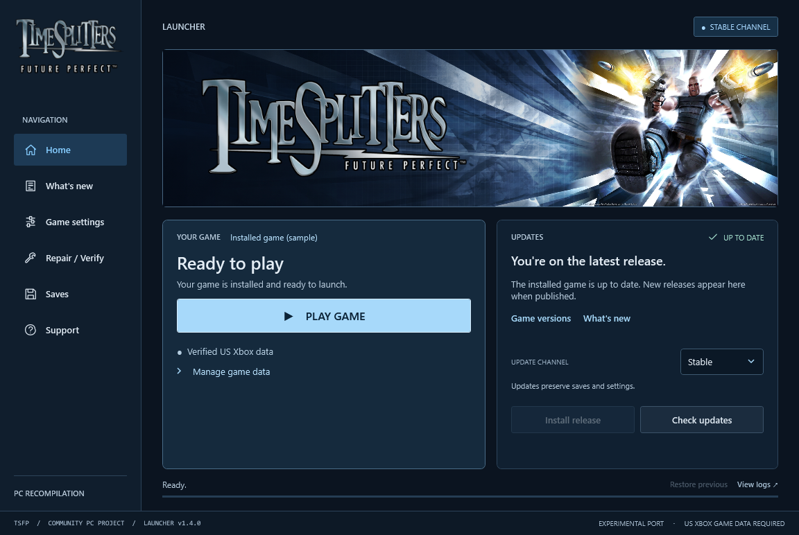

<p align="right">
<a href="https://ko-fi.com/thedoffman"></a>
<a href="https://discord.gg/hFkfcCUm56"></a>
</p>

<div align="center">

# TimeSplitters 3 Limitless

A MapMaker-focused fork of the TimeSplitters: Future Perfect PC port

MapMaker limits raised many times over · New MapMaker tools · PC mouse and control fixes · Bug fixes

<a href="https://github.com/JustinDent/timesplitters3-limitless/releases/latest/download/TimeSplitters-Launcher-windows-x64.zip"></a>
<a href="https://github.com/JustinDent/timesplitters3-limitless/releases/latest/download/TimeSplitters-Launcher-macos-arm64.zip"></a>

<sub><strong>No release of this fork has been published yet.</strong> Build from source for now · <a href="https://github.com/JustinDent/timesplitters3-limitless/releases">Fork releases</a></sub>

**[MapMaker Limitless](#mapmaker-limitless)** · [Player guide](docs/mapmaker/mapmaker-limitless.md) · [Build from source](docs/development/building.md) · [Install & play](#start-playing) · [Credits](#credits)

<sub>Windows 10/11 x64 · Experimental fork · Supported US Xbox game required</sub>

</div>

## What this is

**TimeSplitters 3 Limitless** is an experimental fork of
**[TheDoffman/timesplitters-future-perfect-pc](https://github.com/TheDoffman/timesplitters-future-perfect-pc)**,
the native PC/Mac port of *TimeSplitters: Future Perfect* built on the
**[nemonicicon/ts3FPrecomp](https://github.com/nemonicicon/ts3FPrecomp)** static
recompilation toolkit. Everything the original port provides (native Windows
and Apple Silicon builds, mouse aiming, widescreen, the launcher, Online and
LAN play) comes from that project; see [Credits](#credits).

This fork adds:

- **MapMaker capacity raised many times over** behind one opt-in switch
  (`TSFP_MAPMAKER_LIMITS=1`): 511 tiles, 200 items, up to 255 Story AI, up to
  64 characters alive in a MapMaker Story map, more movable objects, keycards,
  turrets, teleporters and logic, a 512 KB map file and an 8x memory budget.
- **New MapMaker features:** sixteen floors on an 80x80 grid, optional
  overlapping tiles and stacked items, any unlocked character in MapMaker Story,
  Story AI duplicates and linked copies, and a per-map Clouds option.
- **PC control fixes:** MapMaker editor mouse controls, click-to-load in the map
  browser, click-to-confirm on the character screen and mission/event briefings,
  and mouse aiming for mounted
  and vehicle guns.
- **Bug fixes** for MapMaker and System Link memory-safety problems, listed in
  [the bug-fix notes](docs/mapmaker/mapmaker-bugfix.md).

### Status: experimental, not a validated release

- Development builds are compile-only Windows builds tested by the maintainer
  on a separate Windows 11 PC. The combined capacity play test is recorded in
  [STATUS.md](docs/project/STATUS.md) (2026-10-30), and the newer features checked in game on 2026-10-31 are
  listed there too. The rest have automated fixture tests only; the
  [MapMaker Limitless table](#mapmaker-limitless) marks each one.
- No fork release has been published. The download buttons point to this
  fork's [releases page](https://github.com/JustinDent/timesplitters3-limitless/releases),
  which stays empty until a release is made.
- Not yet tested with the fork's changes: System Link, splitscreen, native Mac
  and most story levels.
- MapMaker work lives on the `mapmaker-recon` branch, which is based on the
  original project's `main` at `141f440a` and has since merged the original
  port up to `db029630` (v0.5.3 plus later fixes, 2026-11-07). Later fixes are
  merged when needed. Upstream's Linux and Developer Tools additions came with
  that merge but are not yet tested with the fork's changes.

> [!IMPORTANT]
> You need your own legally obtained **US Xbox** copy of the game (title ID
> `45410066`; `default.xbe` SHA-256
> `3cfd001a84fc3e08175d6c4b2e42ebf49577a089b5d0bd87ac724f61a41816bc`), as an
> ISO or extracted game data. Original game files are not included and are
> never distributed by this project. No emulator is needed.

## MapMaker Limitless

The switches are read when the game starts. Without them the editor keeps the
original limits and features; the always-on bug fixes, mouse controls and
larger play-time capacity remain active.

**With the launcher:** open **Settings → MapMaker** and tick **Raised MapMaker
limits**, **Overlapping tiles** or **Stacked items**, and optionally lower
**Characters alive at once**. Save, then press Play. All are off by default.
The launcher passes only these choices to the game and ignores the variables
below, so set them here rather than in a terminal.

**From source:** the switches are environment variables. Set them in the
PowerShell window you launch from; `tsfp.ps1 -Action Run` passes them on to the
game (`MEMORY_SCALE` and the developer switches exist only this way):

```powershell
$env:TSFP_MAPMAKER_LIMITS = '1'
$env:TSFP_MAPMAKER_STACK_ITEMS = '1'   # optional
.\tsfp.ps1 -Action Run
```

| Switch | Default | Effect | Status |
| --- | --- | --- | --- |
| `TSFP_MAPMAKER_LIMITS=1` | Off | Raised editor limits: 511 tiles (heavy room tiles stop near 386 on the memory budget unless `TSFP_MAPMAKER_ARENA_MB=6`), 200 items, 255 Story AI, x4 keycards, movers and props, more turrets, teleporters, logic and free-standing objects, 512 KB maps and an x8 memory budget. The larger play-time capacity behind them (for example 64 characters alive in a local MapMaker Story map) is always present. Also turns on seven floors and the 80x80 grid, any unlocked character in MapMaker Story, Story AI duplicates and linked copies, and the Clouds checkbox. | Capacity play-tested on Windows (236 tiles, 200 items, 102+ Story AI, 64 characters; see [STATUS.md](docs/project/STATUS.md)). Story AI duplicates and linked copies: reported working by the maintainer. Grid, Story character and Clouds: fixture-tested, no recorded play test yet. |
| `TSFP_MAPMAKER_OVERLAP=1` | Off | Tiles may be placed over other tiles. Overlapping maps can show visual and pathing artefacts by design. | Checked in game (2026-10-31) |
| `TSFP_MAPMAKER_STACK_ITEMS=1` | Off | Several pickups or props in one grid cell. Stacked items spawn on the same spot. | Checked in game (2026-10-31) |
| `TSFP_MAPMAKER_MEMORY_SCALE=2..8` | 8 with `LIMITS`, otherwise off | Divides the editor's play-time memory estimate. | Part of the capacity play test |
| `TSFP_MAPMAKER_ALIVE=1..64` | 64 | Lowers the number of characters alive at once (20 = original) for slower PCs. | Fixture-tested |
| `TSFP_MAPMAKER_POINTER=0` | Mouse on | Turns off the MapMaker editor mouse controls. | Editor mouse checked in game |
| `TSFP_MAPMAKER_POOLS=0` | Pools on | Restores the original AI navigation pools in MapMaker play; also disables `LIMITS`. | Troubleshooting only |
| `TSFP_MAPMAKER_ROOM_MASK_CLEAR=<hex>` | Off | Developer test switch for open-air (sky) tiles. | Work in progress, developer use only |
| `TSFP_MAPMAKER_PROBE=<flags>` | Off | Read-only diagnostic logging ([probe guide](docs/mapmaker/mapmaker-meter-probe.md)). | Developer use |

Maps that fit the original limits save in the original format. Larger maps
are refused for System Link and need this fork to load. Full details, known
limits and test notes: **[MapMaker Limitless guide](docs/mapmaker/mapmaker-limitless.md)**.

**Mouse and control fixes in this fork** (no switch needed): MapMaker editor
mouse controls (pointer, menus, scrollbars, wheel zoom and panning); click a
map in **MapMaker → Load map** to load it; on the character screen, click
anywhere other than another portrait to confirm the previewed character; on a
Story mission briefing or an Arcade League / Challenge event page, click
anywhere (except Back) to start; and
mouse aiming for mounted and vehicle guns (for example the truck gun in
*Scotland the Brave*). Planned, not yet merged: mouse-wheel scope zoom.

<a name="start-playing"></a>

## Start playing

There is no fork release yet. To play the Limitless features, build the game
from source with the [build guide](docs/development/building.md) (Windows: `setup.ps1`,
then `tsfp.ps1 -Action Build`; where Smart App Control blocks locally built
test programs, `tsfp.ps1 -Action Build -CompileOnly`).

The launcher steps below are inherited from the original PC port. Launcher
downloads from this fork will appear on the
[fork releases page](https://github.com/JustinDent/timesplitters3-limitless/releases)
once published; until then the launcher cannot install a Limitless game runtime.

The original port's launcher steps (Windows, Mac and Linux use the same steps):

| Step | Installation |
| :---: | --- |
| **01** | **Download the launcher:** [Windows x64](https://github.com/TheDoffman/timesplitters-future-perfect-pc/releases/latest/download/TimeSplitters-Launcher-windows-x64.zip), [Mac (Apple Silicon)](https://github.com/TheDoffman/timesplitters-future-perfect-pc/releases/latest/download/TimeSplitters-Launcher-macos-arm64.zip), or [Linux x64](https://github.com/TheDoffman/timesplitters-future-perfect-pc/releases/latest/download/TimeSplitters-Launcher-linux-x64.zip). The download starts directly; you can also use the buttons above. |
| **02** | **Extract and open.** Extract the whole ZIP to a writable folder. On Windows, open **TimeSplitters Launcher.exe**, keeping `Bin` and `Support` with it. On Mac, open **TimeSplitters Launcher.app**, keeping its `Support` folder beside it. On Linux, preserve executable permissions and run **Launch.sh** or **TimeSplitters.Launcher**, keeping the full package together. |
| **03** | **Install the game runtime.** Keep **Update channel → Stable**, then choose **Install release**. The launcher downloads and verifies the latest available game build for your platform. Choose a preview only when opting into testing. |
| **04** | **Import your game once.** Choose **Locate ISO**, or **Use extracted files** for a folder containing `default.xbe`, `pak` and `xmv`. |
| **05** | **Press Play Game.** The launcher minimizes while the game runs and returns when you finish. |

**Next time:** open the launcher and choose **Play Game**. Installed play remains
available offline. Use **Check updates → Update release** to install a newer game
build when available. Launcher and game versions are separate.

Source contributors: ordinary clones and builds do not require the Enhanced
texture download. See [cloning without optional textures](CONTRIBUTING.md#clone-without-optional-textures).

### Launcher preview

**Weapon view:** In builds containing the Weapon FOV option, open **Settings →
Video Options → View & HUD → Weapon FOV** from the main or pause menu. Choose
80–150% and select **Apply**; no restart is needed. **Original** is 100%.
Higher values show more of the weapon, independently of the world FOV slider.
These percentages adjust the weapon's original lens, rather than degrees.



Launcher v1.4.0 interface preview with illustrative installation data.
**Stable** is selected, matching the setup instructions above.

<details>
<summary><strong>System requirements, channels and keeping your saves</strong></summary>

- **Windows:** Windows 10/11 x64 with .NET Framework 4.8.
- **Linux:** x64, Ubuntu 24.04 / glibc 2.39 or newer, a desktop display and a working system Vulkan driver. Wayland needs XWayland. See the [Linux launcher guide](docs/players/linux-launcher.md).
- **Mac:** Apple Silicon (M1 or newer). The launcher targets macOS 12+; the
  current shared Vulkan game renderer requires macOS 26+. See the
  [Mac guide](docs/players/macos.md) for the legacy OpenGL fallback on older systems.
- Your supported **US Xbox game**, title ID `45410066`; [exact executable hash](docs/development/building.md#inputs-and-generated-files).
- Internet access for the initial runtime download; about **5 GB** for the game,
  plus space for update staging, rollback and any optional textures.
- **Stable** is the default game channel. Choose **Preview**, then **Beta** or a named feature under **Testing track** for opt-in testing. Each track follows its own updates in launcher 1.3.0+. See [release channels](docs/release/releasing.md).
- Keep the whole installation together, especially `Data`, `Settings`, `Saves`
  and the launcher's recovery files. Normal updates preserve existing data,
  settings and saves.
- **Mac launcher storage:** defaults to `~/Library/Application Support/TimeSplitters`,
  independently of the `.app` location. Existing installations beside the app
  migrate automatically, retaining the original as a backup. Portable mode remains
  available. See [storage and migration](docs/players/macos.md#launcher-storage).

Published builds do not require Python, Git or developer tools. The Mac launcher
includes .NET and does not need CrossOver or the .NET SDK.

</details>

### Platform status

This is an experimental port. Full campaign completion and complete rendering
and audio fidelity remain unverified. See [measured progress](docs/project/STATUS.md).

| Platform | Support and known limits |
| --- | --- |
| **Windows 10/11 x64** | Keyboard and mouse, graphics settings and experimental Online/LAN multiplayer. See the [Windows launcher guide](docs/players/launcher.md), including [startup security prompts](docs/players/launcher.md#windows-security-prompts-at-startup). |
| **Mac (Apple Silicon)** | Native launcher and game; Intel Macs are unsupported. The app is not notarized, so startup may require the [Mac installation and recovery guidance](docs/players/mac-launcher.md#shared-behavior-and-distribution). See [Mac controls and source builds](docs/players/macos.md) and [remaining Mac work](docs/project/MAC_PORT_BACKLOG.md). |
| **Linux x64 (experimental)** | Native launcher and portable SDL/Vulkan game package, validated on Ubuntu/WSL. Native desktop GPU, Wayland, controller and Steam Deck acceptance remain pending. See the [Linux launcher guide](docs/players/linux-launcher.md) and [acceptance limits](docs/development/linux-acceptance.md). |

<a name="pc-features"></a>

##  PC features

| Feature | Details |
| --- | --- |
| **Keyboard and mouse** | Direct aiming, customizable bindings, mouse-driven menus and input prompts that follow your controls. |
| **Widescreen** | 1080p, 1440p, 4K and ultrawide support, with adjustable field of view. |
| **Anti-aliasing** | Optional [SMAA 1x High](docs/players/smaa.md) smooths jagged edges on compatible Direct3D 11/Vulkan builds. |
| **High frame rate** | Original 60 FPS by default; compatible game builds offer opt-in [120/180/240 FPS beta settings](docs/analysis/native-high-refresh.md). |
| **Launcher** | Game installation, updates, repair, rollback and settings. |
| **Local split-screen** | Play with multiple players on the same screen using controllers. |
| **Online multiplayer** | Player-hosted Online and LAN matches with bot support. Windows only. |
| **Extras** | Optional [Discord Rich Presence](docs/players/discord-presence.md), FPS overlays and local crash diagnostics. |

Availability depends on your platform and installed game version. Check the
launcher's **Release notes**, [platform status](#platform-status) and
[measured progress](docs/project/STATUS.md) for support and known limits.

## Multiplayer

### Local split-screen

1. Connect your controllers and choose the number
   of players.
2. Press **Start** on your controllers in the order you want to join.
3. Select or create a profile, then continue.

Join assignments last for the session. To configure the devices manually, use the launcher
or the in-game **Controls > General > Local multiplayer**.

**Automatic**
lets the game use a connected controller without a fixed assignment. To change the player count, return to the main menu;
joining during an active match is not supported. Only one keyboard/mouse player
is supported; additional players need controllers.

### Online / LAN

Choose **Online / System Link → Online** to host or join a match,
or **System Link** for LAN play. Everyone needs matching game builds and data.
Online hosts need port forwarding; guests join using the host's invitation.
Follow the [multiplayer guide](docs/players/multiplayer.md) for setup, ports and bots.

Online is experimental;
Story co-op is not supported yet.

## Enhanced textures

The partial texture overhaul is an optional launcher download for Windows, Mac
and Linux.
**Classic** textures remain the default.

When the optional pack is available, use **Game settings → Graphics & resolution
→ Check texture downloads**, then **Download / update textures**. Enable and save
**Use enhanced textures (Beta)** to use it on future launches. See the
[texture guide](docs/textures/textures.md) for availability, coverage and known issues.

## Developer Tools

Enable **Developer Tools** in **Extras > Developer Tools** or the launcher, then
press **F1** to open the sidebar. It includes free camera, no-clip, game speed,
input/video settings, and diagnostics. Change its shortcut in **Key bindings**.

In multiplayer, the host controls the **Tools** tab through **Options > Developer
Tools** (default **Off**). **Settings** and **Diagnostics** remain accessible;
**Time & audio** and **Player & progression** are unavailable online.

Native Mac/Linux validation is pending; see [validation](docs/project/STATUS.md).

<a name="guides--support"></a>

##  Guides & support

[All documentation](docs/README.md) · [Repository layout and naming](docs/development/repository-layout.md)

| Playing | Development |
| --- | --- |
| [Windows launcher](docs/players/launcher.md) | [Build from source](docs/development/building.md) |
| [Mac launcher](docs/players/mac-launcher.md) | [Native Mac build](docs/players/macos.md) |
| [Controls & display](docs/players/windows-settings.md) | [Shared Windows/Mac architecture](docs/development/shared-platform.md) |
| [Multiplayer](docs/players/multiplayer.md) | [Release publishing](docs/release/releasing.md) |
| [Textures](docs/textures/textures.md) | [Isolated gameplay testing](docs/development/testing-profile.md) |
| [Crash reports](docs/players/windows-crash-logger.md) | [Repository map for agents](docs/agent-context/README.md) |
| [MapMaker Limitless](docs/mapmaker/mapmaker-limitless.md) | [Fork architecture](docs/development/architecture.md) |

**[Report a bug](https://github.com/JustinDent/timesplitters3-limitless/issues/new?template=01-bug-report.yml)**
with your installed versions, platform and steps to reproduce. The launcher's
**Diagnostics** page provides local reports and logs; nothing uploads automatically.
Keep personal saves and game data private.

Suggest improvements in **[Ideas](https://github.com/JustinDent/timesplitters3-limitless/discussions/categories/ideas)**.
To contribute, read the [contributing guide](CONTRIBUTING.md),
[project rules](AGENTS.md) and [code of conduct](CODE_OF_CONDUCT.md).
Report security vulnerabilities privately using the [security policy](SECURITY.md).

<a name="credits"></a>

## Credits & license

- **Original PC port:** [TheDoffman/timesplitters-future-perfect-pc](https://github.com/TheDoffman/timesplitters-future-perfect-pc)
  by TheDoffman and contributors: the Windows and native Mac ports, launcher,
  controls, display, multiplayer, textures and most of this repository's code
  and documentation. TimeSplitters 3 Limitless is a fork of that project.
- **Recompilation toolkit:** [nemonicicon/ts3FPrecomp](https://github.com/nemonicicon/ts3FPrecomp)
  and its contributors.
- **This fork:** [JustinDent/timesplitters3-limitless](https://github.com/JustinDent/timesplitters3-limitless)
  adds the MapMaker capacity raise, MapMaker features, control and bug fixes
  described [above](#mapmaker-limitless).

The port is built on ts3FPrecomp
with local runtime patches and platform adapters. This community project
statically recompiles the Xbox executable into native code; it does not recover
the original C/C++ source. The pinned runtime source is bundled in `vendor/ts3FPrecomp`, and the original port's [independent tooling replacement](docs/development/independent-runtime.md) is in progress. [Pinned upstream and licensing →](docs/development/building.md#upstream-and-licensing)

This repository contains port code, patches and tooling. Original game assets,
the Xbox executable, generated game code, personal settings and saves remain
local. Retain the applicable upstream and third-party licenses with builds.

Original project code and documentation are licensed under **GPL-3.0-only**,
except where stated otherwise. See [LICENSE](LICENSE) and [NOTICE](NOTICE).
When distributing GPL-covered binaries, provide corresponding source and build
instructions and preserve the required notices. Upstream and third-party
components retain their own [licenses and credits](LICENSES/README.md).

**This license does not cover the original TimeSplitters game or its assets.**
You must supply your own supported game files. Original game data, generated
game code, personal settings and saves are not included in this repository.

The [Linux x64 launcher](docs/players/linux-launcher.md) uses the shared desktop
interface and installs the matching Linux game package. See the Linux guide for
desktop prerequisites and the experimental port's remaining validation limits.
